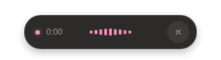
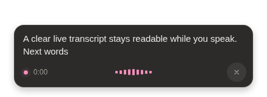

# Handy Linux

A Linux-focused fork of [Handy](https://github.com/cjpais/Handy), based on v0.9.8.
Handy turns speech into text locally. This fork keeps its transcription engine
and concentrates on the recording overlay.





## What changes

- A backport of the WebKitGTK 2.54 renderer fix, so the complete popup keeps painting on modern Linux.
- A larger floating pill with a spring entrance and microphone-reactive waveform.
- Elapsed recording time in both compact and live modes.
- A 32-pixel cancel target, translated label, and visible keyboard focus.
- A readable live transcript that expands from the same pill.
- Light and dark themes, reduced-motion support, and space around the overlay
  for its shadow.
- Omarchy palette sync for the popup and settings window when Appearance is
  set to System. Visible windows pick up theme changes within two seconds.
- A separate application identifier and data directory, so upstream settings
  and recordings remain separate.
- Upstream automatic updates are disabled. Install updates from this fork's
  packages to keep the Linux changes.

Wayland uses GTK layer shell when the compositor supports it. The overlay does
not request keyboard focus. X11 and other Wayland compositors retain upstream's
window fallback. Each compositor still needs testing before compatibility can
be claimed.

## Build

Install the Linux prerequisites in [BUILD.md](BUILD.md), plus Rust and Bun.

```sh
bun install --frozen-lockfile
bun run tauri build --bundles deb
```

The package is in `src-tauri/target/release/bundle/deb/`. A `.deb` built on a
rolling distribution can require newer libraries than Ubuntu or Debian provide.
Use the Linux package workflow for Ubuntu 24.04 builds. AppImage and RPM builds
use upstream's build system but are not part of this fork's initial validation.

## Install without root

The installer needs `ar` and `tar`. Install the runtime libraries listed in
[BUILD.md](BUILD.md) through your distribution's package manager first.

```sh
bash scripts/install-linux.sh path/to/Handy-Linux.deb
~/.local/bin/handy-linux
```

Quit Handy Linux before running the installer again.

The installer writes only to `~/.local/opt/handy-linux`, `~/.local/bin`, and
`~/.local/share/applications`. It does not change desktop shortcuts or remove
upstream Handy. Quit the old instance before switching your shortcut.

For Hyprland's traditional configuration:

```ini
exec-once = ~/.local/bin/handy-linux --start-hidden
bind = SUPER, H, exec, ~/.local/bin/handy-linux --toggle-transcription
```

For Omarchy's Lua configuration, replace the existing Handy commands with:

```lua
o.launch_on_start(os.getenv("HOME") .. "/.local/bin/handy-linux --start-hidden")
o.bind("SUPER + H", "Toggle Handy Linux dictation", os.getenv("HOME") .. "/.local/bin/handy-linux --toggle-transcription")
```

Other desktops can bind the same `--toggle-transcription` command. Keep one
autostart entry and one shortcut. Add a separate `--cancel` shortcut if desired.

On Omarchy, leave **About → Application Theme** set to **System**. Handy Linux reads
`~/.local/state/omarchy/current/theme/colors.toml` and follows its background,
text, accent, and light/dark mode. No Omarchy hook or restart is needed. Explicit
Light or Dark settings override this integration. If that palette file is
unavailable, System follows the desktop's normal light/dark preference.

## Existing Handy data

Handy Linux stores data in `~/.local/share/io.github.handy-linux/`.
It does not automatically import settings, recordings, or credentials.
To reuse settings, quit both apps and copy `settings_store.json` from
`~/.local/share/com.pais.handy/` into the new data directory. Copy `models/` too,
or download a model inside Handy Linux. Settings can contain API credentials:
keep them private and never add them to the repository.

## Checks

```sh
bun run build
bun run lint
bun run test:keyboard
bunx playwright install chromium
bunx playwright test -c playwright.overlay.config.ts
cd src-tauri
cargo fmt --check
cargo clippy --locked
```

The overlay tests simulate Tauri events. They verify timer behavior, cancel
dispatch, state changes, and window bounds. They do not replace a native
Wayland check of rendering, focus, microphone capture, and text insertion.

## License and attribution

MIT, as in [LICENSE](LICENSE). Handy was created by CJ Pais and its contributors.
Handy Linux is an independent fork and is not an official Handy release.
Upstream links in the original documentation describe upstream Handy.
The renderer fix is adapted from Evgeny Khudoba’s [upstream PR #2360](https://github.com/cjpais/Handy/pull/2360), commit `f3d8b876fc100d85f95e5ce1c1299c0ebaf90be5`.

See [README.md](README.md) for the original project documentation.
